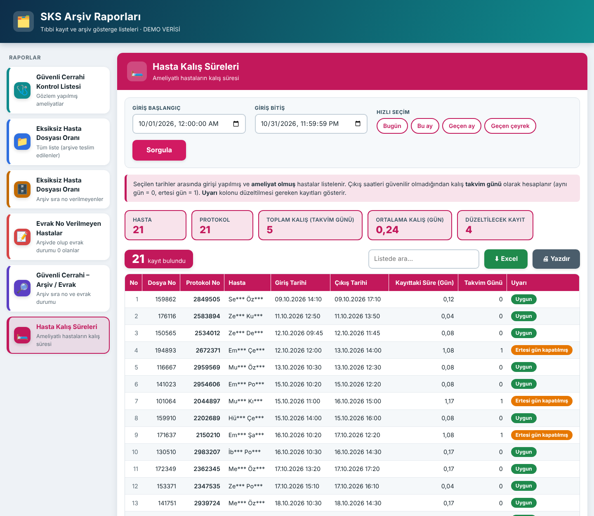

# 🗂️ SKS Medical Records & Archive Reports

**The quality indicator lists a hospital archive needs, one click away.**

A web tool for the medical records / archive unit of hospitals following the Turkish Health Quality Standards (SKS). It turns raw hospital information system (HBYS) data into the lists that quality audits ask for, and shows exactly **which records need fixing**.

Built and used in a private hospital, then open-sourced with all patient and institutional data removed.



> 🇹🇷 Arayüz Türkçedir. Ekrandaki tüm hasta adları ve numaralar **demo verisidir**.

---

## Reports

| Report | What it shows |
|---|---|
| 🩺 **Safe Surgery Checklist** | Surgeries with safety observation done, checklist compliance, and surgeon / anaesthetist notes |
| 📁 **Complete Patient File Rate: full list** | All discharged files delivered to the archive, complete or not |
| 🗄️ **Complete Patient File Rate: no archive number** | Files marked complete but with no archive number; these push the rate above 100% |
| 📝 **Missing document status** | Archived files whose document status was never set |
| 🔎 **Safe Surgery: archive / documents** | Archive number and document status for every safe surgery patient |
| 🛏️ **Length of stay** | Length of stay for surgical patients in calendar days, with records to fix flagged (e.g. protocol left open) |

Every report has quick date ranges (this month, last month, last quarter), summary boxes, search, sorting, **Excel export** and print layout. Protocol numbers can be copied in one click for correction in the HBYS.

## Security & privacy

- **Read-only.** The app only runs `SELECT` queries. Use a dedicated read-only database user.
- **Access control.** An optional IP allowlist and HTTP Basic login protect patient data (KVKK / GDPR).
- **No data leaks.** Database errors are logged on the server only; the browser gets a generic message.
- **No caching.** Patient lists are sent with `Cache-Control: no-store` and anti-framing headers.
- **No secrets in the repo.** Credentials live in `config.ini`, which is git-ignored.

## Quick start

**Try it without a database (demo data):**
```bash
pip install -r requirements.txt
DEMO=1 python app.py            # Windows: set DEMO=1 && python app.py
```
Open `http://localhost:5050`.

**With your HBYS (Oracle):**
1. Copy `config.ini.ornek` to `config.ini` and fill in the database details.
2. On Windows: run `kurulum.bat` as administrator once, then `baslat.bat`.

## Tech stack

`Python` · `Flask` · `python-oracledb` · `openpyxl` · `Waitress` · Vanilla JS

The SQL targets the `HASTANE` schema of an Oracle-based HBYS. For a different HBYS, adapt the table and column names in `raporlar.py`. Adding a new report takes one dictionary entry: menu name, description, SQL and columns.

## Related projects

- [surgical-safety-checklist-audit](https://github.com/bigwarstart/surgical-safety-checklist-audit): SKS safe surgery indicator audit
- [lens-stock-expiry-tracker](https://github.com/bigwarstart/lens-stock-expiry-tracker): intraocular lens stock & expiry tracking
- [his-protocol-autofill](https://github.com/bigwarstart/his-protocol-autofill): one-click protocol number entry into the HBYS
- [clinic-intranet](https://github.com/bigwarstart/clinic-intranet): secure hospital intranet

## Author

**Fatih Koçan**: IT Manager with 25+ years in hospital IT, Web3 developer & ambassador

[](https://www.linkedin.com/in/fatihkocan-3bbb49349/)
[](https://github.com/bigwarstart)
